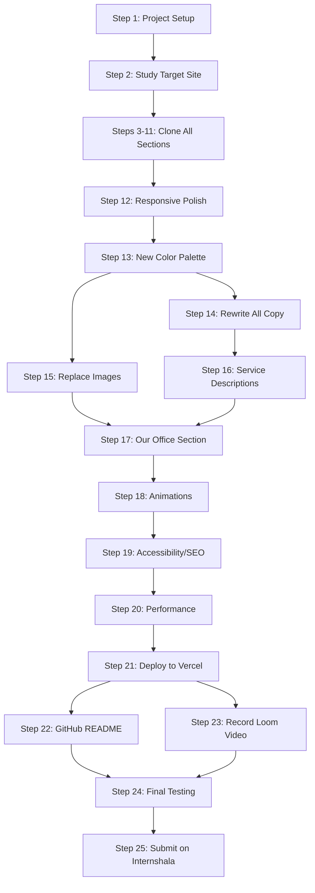

# Grow My Therapy - Implementation Plan & Roadmap

---

## PART A: IMPLEMENTATION PLAN

---

### 1. Target Website Section Breakdown

The website you need to clone is: [conejovalleycounseling.com/home](https://www.conejovalleycounseling.com/home)

It is a Squarespace site with the following sections (top to bottom):

| # | Section | Content |
|---|---------|---------|
| 1 | **Navigation Bar** | Logo (left) + Nav links (right) + "Book Online" CTA button |
| 2 | **Hero Section** | Full-width background image + large heading + subheading + CTA button |
| 3 | **Welcome / Intro** | Centered text block, welcoming message, brief description |
| 4 | **Services Cards** | 3-column grid of service cards (image + title + description + link) |
| 5 | **About / Bio** | Split layout (image left + text right) with therapist photo and bio |
| 6 | **Approach / Methods** | Section explaining therapy approaches (may include icons/list) |
| 7 | **Testimonials** | Client testimonials/quotes in a styled layout |
| 8 | **FAQ Accordion** | Expandable FAQ items (click to open/close) |
| 9 | **CTA / Contact** | Final call-to-action with "Book Now" or "Get in Touch" button |
| 10 | **Footer** | Logo, links, contact info, social media icons, copyright |

**Typography:**
- Headings: **Cormorant Infant** (serif, elegant)
- Body: **Muli** (sans-serif, clean)

**Color Scheme:** Warm earth tones (beige, sage green, muted gold)

---

### 2. Architecture Decisions

| Decision | Choice | Why |
|----------|--------|-----|
| Framework | **Next.js (App Router)** | Required by assignment |
| Styling | **Tailwind CSS** | Required by assignment |
| UI Library | **ShadCN UI** | Pre-built, accessible, Tailwind-native components |
| Language | **TypeScript** | Professional standard, shows competence |
| Fonts | **Google Fonts** (Cormorant Garamond + Inter for clone, then change for redesign) | Free, fast loading |
| Images | **Unsplash / Pexels** (free stock) + Google Drive office photos | High quality, free |
| Deployment | **Vercel** | One-click deploy for Next.js |
| Components | ShadCN + custom components | Clean, accessible, professional |

**ShadCN Components You Will Use:**

| ShadCN Component | Used For |
|-----------------|----------|
| `Button` | All CTA buttons (Book consultation, Learn more) |
| `Accordion` | FAQ section (built-in expand/collapse + animation) |
| `Sheet` | Mobile navigation (slide-out menu) |
| `Card` | Service cards (image + title + description) |
| `Dialog` | Optional: Contact form popup |
| `Separator` | Visual dividers between sections |
| `Badge` | Service tags (In-person, Telehealth) |

---

### 3. Folder Structure

```
grow-my-therapy/
├── public/
│   └── images/
│       ├── hero.jpg
│       ├── about.jpg
│       ├── office-1.jpg
│       ├── office-2.jpg
│       ├── office-3.jpg
│       └── services/
│           ├── anxiety.jpg
│           ├── trauma.jpg
│           └── burnout.jpg
├── src/
│   ├── app/
│   │   ├── layout.tsx          (root layout with fonts, metadata)
│   │   ├── page.tsx            (homepage - assembles all sections)
│   │   └── globals.css         (Tailwind + ShadCN theme + custom styles)
│   ├── components/
│   │   ├── ui/                 (ShadCN components - auto-generated)
│   │   │   ├── button.tsx
│   │   │   ├── accordion.tsx
│   │   │   ├── card.tsx
│   │   │   ├── sheet.tsx
│   │   │   ├── badge.tsx
│   │   │   ├── separator.tsx
│   │   │   └── dialog.tsx
│   │   ├── sections/           (your custom page sections)
│   │   │   ├── Navbar.tsx
│   │   │   ├── Hero.tsx
│   │   │   ├── Welcome.tsx
│   │   │   ├── Services.tsx
│   │   │   ├── About.tsx
│   │   │   ├── Approach.tsx
│   │   │   ├── Testimonials.tsx
│   │   │   ├── FAQ.tsx
│   │   │   ├── OurOffice.tsx   (NEW custom section)
│   │   │   ├── CTA.tsx
│   │   │   └── Footer.tsx
│   │   └── ServiceCard.tsx
│   ├── lib/
│   │   └── utils.ts            (ShadCN cn() utility)
│   └── data/
│       ├── services.ts         (service data array)
│       ├── faq.ts              (FAQ data array)
│       └── testimonials.ts     (testimonial data array)
├── components.json             (ShadCN config)
├── tailwind.config.ts
├── next.config.ts
├── package.json
└── README.md
```

---

### 4. Color Palette Plan

**For the Clone (matching original):**
- Background: Warm beige/cream tones
- Text: Dark brown/charcoal
- Accent: Sage green / muted gold

**For the Redesign (Dr. Maya Reynolds):**

| Token | Color | Hex (suggested) | Why |
|-------|-------|-----------------|-----|
| Primary | Deep Teal | `#2C6E6F` | Calm, trustworthy, therapeutic |
| Secondary | Warm Sand | `#F5EDE3` | Warm, safe, approachable |
| Accent | Soft Gold | `#C9A96E` | Premium, welcoming |
| Text Primary | Dark Charcoal | `#2D2D2D` | High readability |
| Text Secondary | Warm Gray | `#6B6B6B` | Softer body text |
| Background | Off-White | `#FAFAF7` | Clean, uncluttered feel |
| CTA Button | Deep Teal | `#2C6E6F` | Clear, visible action |

> [!TIP]
> You can finalize colors later, but deciding early prevents rework.

---

### 5. Scoring Strategy

| Criteria | Weight | Your Strategy |
|----------|--------|---------------|
| **Video** | **30%** | Practice script, show desktop + mobile, explain design choices |
| **UI Clone** | **25%** | Pixel-match the original layout, spacing, and typography |
| **Theme/Design** | **25%** | Cohesive calming color palette, consistent throughout |
| **Copy/Images** | **10%** | Every word from Dr. Maya's profile, matching stock photos |
| **New Section** | **10%** | "Our Office" with office photos, smooth design |

---

## PART B: IMPLEMENTATION ROADMAP

---

### Phase 1: Setup & Foundation (Day 1 Morning)

---

#### Step 1: Project Setup (Next.js + Tailwind + ShadCN)

**What to do:**
- Create a new Next.js project with TypeScript and Tailwind CSS
- Initialize **ShadCN UI** (`npx shadcn@latest init`)
- Install ShadCN components you need:
  ```
  npx shadcn@latest add button accordion card sheet badge separator
  ```
- Configure `tailwind.config.ts` with custom colors, fonts, and spacing
- Install Google Fonts (Cormorant Garamond + Muli/Inter)
- Set up the folder structure shown above
- Initialize Git and make the first commit

**Why do this first:**
Everything depends on the project existing. ShadCN must be initialized early because it configures your Tailwind theme, `globals.css`, and `cn()` utility. Setting up Tailwind tokens (colors, fonts) early means every component you build will automatically use the right design system.

**Technologies:** Next.js 14+, TypeScript, Tailwind CSS, **ShadCN UI**, Google Fonts (`next/font`)

**Key decisions:**
- Use App Router (not Pages Router)
- Use `next/font` for font optimization (zero layout shift)
- ShadCN style: choose "Default" style and "Slate" base color during init (you will customize later)
- Set up both clone colors AND redesign colors in Tailwind config (you can toggle later)

**Common mistakes to avoid:**
- Do NOT use `create-react-app`. Use `create-next-app`
- Do NOT skip TypeScript. It shows professionalism
- Do NOT install unnecessary packages. Keep it clean
- Do NOT install ALL ShadCN components. Only install what you need

**How to verify:**
- `npm run dev` works without errors
- Tailwind classes render correctly
- Fonts load properly on the page

---

#### Step 2: Study the Target Website Thoroughly

**What to do:**
- Open [conejovalleycounseling.com/home](https://www.conejovalleycounseling.com/home)
- Open DevTools (F12) and inspect every section
- Note down: exact spacing (padding/margin), font sizes, font weights, colors, grid columns, image aspect ratios
- Take screenshots of desktop, tablet (768px), and mobile (375px) views
- Save these screenshots in your project folder for reference

**Why do this now:**
You cannot clone something you have not studied. Spending 30-45 minutes here saves hours of "guessing" later.

**What to note for each section:**
```
Section Name: ___
Layout: (full-width / contained / split)
Columns: (1 / 2 / 3)
Background Color: ___
Heading Font: ___ (size, weight)
Body Font: ___ (size, weight)
Padding: (top, bottom)
Any special effects: (hover, animation, shadow)
```

**Common mistakes to avoid:**
- Do NOT start coding without studying the site first
- Do NOT ignore mobile layout. They will check it

**How to verify:**
- You have a written list of every section with its properties
- You have screenshots at 3 breakpoints (desktop, tablet, mobile)

---

### Phase 2: Clone the Homepage (Day 1 Afternoon + Day 2)

---

#### Step 3: Build the Navigation Bar

**What to do:**
- Create `Navbar.tsx` with logo (left), nav links (center/right), and CTA button
- Use **ShadCN `Button`** for the "Book Online" CTA
- Use **ShadCN `Sheet`** for mobile navigation (slide-out side menu)
- Match the original styling closely

**Why do this first among components:**
The navbar appears on every page and sets the visual tone. It is the first thing evaluators see.

**Why ShadCN Sheet for mobile nav:**
A slide-out sheet looks more polished than a basic dropdown. It includes overlay, close button, and smooth animation automatically.

**Common mistakes to avoid:**
- Do NOT build a custom mobile menu from scratch when ShadCN Sheet exists
- Do NOT forget the "Book Online" CTA button

**How to verify:**
- Navbar looks identical to the original on desktop
- Mobile hamburger menu opens/closes properly
- CTA button is clearly visible

---

#### Step 4: Build the Hero Section

**What to do:**
- Full-width background image with overlay
- Large heading (H1) + subheading
- CTA button centered or left-aligned (match original)
- Ensure text is readable over the background image

**Key decisions:**
- Use `next/image` for optimized image loading
- Use a dark overlay on the background image for text readability

**Common mistakes to avoid:**
- Do NOT use a low-quality image. Use high-resolution (1920x1080+)
- Do NOT forget to add proper `alt` text for accessibility

**How to verify:**
- Hero looks identical to original at all breakpoints
- Image loads fast (no layout shift)
- Text is readable on all screen sizes

---

#### Step 5: Build the Welcome/Intro Section

**What to do:**
- Centered text block with welcoming message
- Match font sizes, line height, and spacing

**How to verify:**
- Spacing matches the original

---

#### Step 6: Build the Services Section (3-Column Grid)

**What to do:**
- Create `ServiceCard.tsx` as a reusable component (image + title + description + link)
- Create `Services.tsx` that renders 3 ServiceCards in a grid
- Use Tailwind grid: `grid grid-cols-1 md:grid-cols-3 gap-8`
- Store service data in `src/data/services.ts`

**Why use a data file:**
Separating data from UI makes it easy to swap content for the redesign later. You just change the data file.

**Common mistakes to avoid:**
- Do NOT hardcode service text inside JSX. Use a data array
- Do NOT forget hover effects on cards

**How to verify:**
- 3 cards on desktop, stacked on mobile
- Hover effects work
- Images load correctly

---

#### Step 7: Build the About/Bio Section

**What to do:**
- Split layout: image on one side, text on the other
- Therapist photo + bio text + optional CTA
- Responsive: stacks vertically on mobile

**How to verify:**
- Image and text are side by side on desktop
- Stacks properly on mobile

---

#### Step 8: Build the Approach/Methods Section

**What to do:**
- Section explaining therapy approaches
- May include icons or a list format
- Match the original layout

---

#### Step 9: Build the Testimonials Section

**What to do:**
- Styled quote cards or a simple testimonial layout
- Include quotation marks, client name (first name only)

---

#### Step 10: Build the FAQ Accordion

**What to do:**
- Use **ShadCN `Accordion` component** (already installed!)
- Store FAQ data in `src/data/faq.ts`
- Map through FAQ data and render `AccordionItem` for each question
- ShadCN Accordion already includes smooth animation, accessibility, and keyboard support

**Example usage:**
```tsx
import { Accordion, AccordionContent, AccordionItem, AccordionTrigger } from "@/components/ui/accordion"

<Accordion type="single" collapsible>
  {faqs.map((faq) => (
    <AccordionItem key={faq.id} value={faq.id}>
      <AccordionTrigger>{faq.question}</AccordionTrigger>
      <AccordionContent>{faq.answer}</AccordionContent>
    </AccordionItem>
  ))}
</Accordion>
```

**Why ShadCN here:**
Saves you 30+ minutes of writing custom accordion logic. Built-in accessibility (ARIA attributes, keyboard nav) and smooth animations out of the box.

**How to verify:**
- Click a question -> answer slides open
- Click again -> answer slides closed
- Only one question open at a time (collapsible mode)
- Tab + Enter works for keyboard users

---

#### Step 11: Build the CTA Section and Footer

**What to do:**
- CTA: Final "Book a Consultation" section with button
- Footer: Logo, navigation links, contact info, copyright

**How to verify:**
- Footer matches the original structure
- Links are styled correctly

---

#### Step 12: Responsive Polish for Clone

**What to do:**
- Test at 3 breakpoints: Desktop (1440px), Tablet (768px), Mobile (375px)
- Fix any layout issues, text overflow, image sizing
- Check the original site at each breakpoint and match it

**How to verify:**
- Open DevTools, toggle device toolbar
- Compare side-by-side with the original at each breakpoint

---

### Phase 3: Redesign for Dr. Maya Reynolds (Day 3 + Day 4)

---

#### Step 13: Apply New Color Palette

**What to do:**
- Update `tailwind.config.ts` with the new Dr. Maya color tokens
- Replace all color references throughout the components
- Ensure consistent use of design tokens (never hardcode hex values)

**Key decisions:**
- Deep Teal + Warm Sand + Soft Gold (calming, therapist-appropriate)

**How to verify:**
- All sections use the new palette consistently
- No leftover original colors
- Good contrast (use WebAIM contrast checker)

---

#### Step 14: Rewrite All Copy

**What to do:**
- Replace ALL text based strictly on Dr. Maya Reynolds' profile
- Target sections to rewrite:

| Section | Original Content | New Content (Dr. Maya) |
|---------|-----------------|----------------------|
| H1 | "Counseling in Newbury Park..." | "Anxiety and trauma therapist in Santa Monica..." |
| Subheading | Generic welcome | "You"-focused, safe, warm tone |
| Services | Original 3 services | Anxiety, Trauma, Burnout (from her profile) |
| About | Original therapist bio | Dr. Maya's full bio from the Google Doc |
| FAQs | Original FAQs | Rewrite for Santa Monica / Dr. Maya context |
| CTAs | "Book Online" | "Book a free consultation" |
| Testimonials | Original quotes | Write realistic fictional testimonials matching her specialties |

**Common mistakes to avoid:**
- Do NOT copy text directly from ChatGPT without making it sound human
- Do NOT forget local SEO keywords ("Santa Monica", "California")
- Do NOT use the em dash character

**How to verify:**
- Every piece of text on the page is unique to Dr. Maya
- No leftover text from the original website
- Keywords "Santa Monica" appear naturally 3-5 times

---

#### Step 15: Source and Replace All Images

**What to do:**
- Find high-quality stock photos from [Unsplash](https://unsplash.com) or [Pexels](https://pexels.com)
- Hero: Calming therapy office or Santa Monica nature scene
- About: Professional headshot of a female therapist (stock photo)
- Services: Relevant images for anxiety, trauma, burnout
- Download office photos from [Google Drive folder](https://drive.google.com/drive/folders/1fbAMSdqGF_ltNc0JiltkpIr_C26kRvLs?usp=drive_link) for the "Our Office" section
- Optimize all images (compress, convert to WebP)

**Common mistakes to avoid:**
- Do NOT use low-resolution or pixelated images
- Do NOT use images that clash with your color palette
- Do NOT forget to add `alt` text to every image

**How to verify:**
- All images are high quality and match the calming theme
- All images have descriptive `alt` text
- No broken image links

---

#### Step 16: Pick and Describe 3 Services

**What to do:**
- Based on Dr. Maya's profile, create 3 service cards:
  1. **Anxiety & Panic Therapy in Santa Monica** - CBT, mindfulness
  2. **Trauma Counseling in Santa Monica** - EMDR, somatic techniques
  3. **Burnout & Perfectionism Therapy** - For high-achievers, entrepreneurs

- Write 2-3 sentences per service, include SEO keyword once per description

---

### Phase 4: Custom Section + Polish (Day 4 Afternoon)

---

#### Step 17: Build the "Our Office" Custom Section

**What to do:**
- Create `OurOffice.tsx` component
- Title: "A Calm Space for Healing" or "Our Office"
- Layout: 2-3 office photos in a grid/carousel
- Supporting text about:
  - Natural light, calm, grounding environment
  - Located in Santa Monica, CA
  - Both in-person and telehealth options
  - Privacy and comfort emphasis
- Place this section between Testimonials and FAQ (or after About)

**Why this placement:**
After seeing testimonials, the user wonders "what would the actual experience feel like?" The office section answers that.

**Common mistakes to avoid:**
- Do NOT just dump 3 images without context. Add warm, descriptive text
- Do NOT use tiny images. Use large, high-quality photos

**How to verify:**
- Section looks natural in the page flow
- Images load correctly
- Responsive on all devices

---

#### Step 18: Animations & Polish

**What to do:**
- Add subtle scroll-reveal animations (fade-in-up on sections)
- Add hover effects on buttons (scale, shadow, color shift)
- Add hover effects on service cards (lift/shadow)
- Smooth FAQ accordion animation (height transition)
- Smooth scroll for anchor links

**Common mistakes to avoid:**
- Do NOT over-animate. This is a therapist's website, not a gaming site
- Keep animations subtle and calming (200-400ms duration, ease-out)

**How to verify:**
- Animations feel smooth and professional
- Nothing feels jarring or flashy

---

#### Step 19: Accessibility & SEO

**What to do:**
- Semantic HTML: `<nav>`, `<main>`, `<section>`, `<article>`, `<footer>`
- One `<h1>` per page (the Hero heading)
- Proper heading hierarchy (h1 -> h2 -> h3)
- `alt` text on all images
- Focus-visible ring on all interactive elements
- Add `<title>` and `<meta description>` in `layout.tsx`
- Color contrast ratio check (WCAG AA minimum)

**How to verify:**
- Run Lighthouse audit (aim for 90+ on Accessibility)
- Tab through the page with keyboard only

---

### Phase 5: Deploy & Submit (Day 5)

---

#### Step 20: Performance Optimization

**What to do:**
- Compress all images (use [TinyPNG](https://tinypng.com/) or [Squoosh](https://squoosh.app/))
- Use `next/image` with proper `width`, `height`, and `priority` props
- Lazy load images below the fold
- Run Lighthouse audit (aim for 90+ on Performance)

---

#### Step 21: Deploy to Vercel

**What to do:**
- Push code to GitHub (public repository)
- Connect GitHub repo to Vercel
- Deploy with one click
- Get your live URL (e.g., `grow-my-therapy.vercel.app`)

**How to verify:**
- Live URL loads correctly
- All images load
- Responsive on real mobile device (test on your phone)

---

#### Step 22: Push to GitHub with Clean README

**What to do:**
- Write a professional README.md:
  ```
  # Dr. Maya Reynolds - Therapist Website
  
  A custom-designed, responsive therapist website built with 
  Next.js and Tailwind CSS for GrowMyTherapy.
  
  ## Live Demo
  [View Website](your-vercel-url)
  
  ## Tech Stack
  - Next.js 14 (App Router)
  - TypeScript
  - Tailwind CSS
  
  ## Features
  - Responsive design (desktop, tablet, mobile)
  - SEO optimized for Santa Monica, CA
  - Custom "Our Office" section
  - Accessible (semantic HTML, focus states)
  - Optimized images with next/image
  
  ## Getting Started
  npm install
  npm run dev
  ```

---

#### Step 23: Record the Loom Video (Day 5)

**What to do:**
- Sign up at [loom.com](https://www.loom.com/) (free)
- Record a 5-minute video structured as a CLIENT DEMO:

**Script outline:**
```
[0:00 - 0:30] Introduction
"Hi, I am Karunasindhu Adak. I would like to walk you through 
the website I built for Dr. Maya Reynolds."

[0:30 - 2:00] Desktop Walkthrough
- Show Hero section, explain H1 and SEO keyword choice
- Show Services section, explain why these 3 services
- Show About section, explain how bio matches the profile
- Show "Our Office" section, explain design choice
- Show FAQ section, show accordion interaction

[2:00 - 3:00] Design Decisions
- Explain color palette (why teal + sand + gold)
- Explain typography choices
- Explain why the design feels calm and trustworthy

[3:00 - 4:00] Mobile Responsive Demo
- Resize browser or use DevTools
- Show how every section adapts
- Show mobile navigation

[4:00 - 5:00] Wrap Up
- Mention local SEO choices (Santa Monica keywords)
- Mention accessibility features
- "Thank you for reviewing. I look forward to your feedback."
```

**Common mistakes to avoid:**
- Do NOT speak in technical jargon (no "I used flex-col on md breakpoint")
- Do NOT go over 5 minutes
- Do NOT forget to show mobile view
- DO show your face (small camera bubble)
- DO speak clearly and confidently

**How to verify:**
- Watch your own video. Does it sound professional?
- Is it under 5 minutes?
- Did you show both desktop and mobile?

---

#### Step 24: Final Testing

**What to do:**
- Test deployed URL on your phone (real device)
- Test on Chrome, Edge, Firefox
- Check all links work
- Check all images load
- Run final Lighthouse audit

---

#### Step 25: Submit on Internshala

**What to do:**
- Go to Internshala chat with Grow My Therapy
- Click "Submit Assignment"
- Provide all 3 deliverables:
  1. **Live URL:** `https://your-site.vercel.app`
  2. **GitHub:** `https://github.com/karunasindhuadak/grow-my-therapy`
  3. **Video:** `https://www.loom.com/share/your-video-id`
- Add a note:
  ```
  Dear Sir, please find my completed assignment:
  
  Live Website: [URL]
  GitHub Repository: [URL]
  Video Walkthrough: [URL]
  
  Thank you for this opportunity.
  
  Best regards,
  Karunasindhu Adak
  ```

---

## DAY-BY-DAY TIMELINE

> **Deadline: October 14, 2026 at 11:49 PM IST (strict)**
> **Time remaining from now: ~4.5 days**

| Day | Date | Time Available | Tasks | Steps |
|-----|------|---------------|-------|-------|
| **Day 1** | Oct 10 (Fri) - TODAY | ~8h (3 PM onwards) | Setup + Study target site + Start cloning | Steps 1-5 |
| **Day 2** | Oct 11 (Sat) | Full day (~10h) | Complete the clone (all remaining sections + responsive) | Steps 6-12 |
| **Day 3** | Oct 12 (Sun) | Full day (~10h) | Redesign: colors, copy, images, services | Steps 13-16 |
| **Day 4** | Oct 13 (Mon) | Full day (~10h) | Custom section + animations + accessibility + deploy | Steps 17-22 |
| **Day 5** | Oct 14 (Tue) ⚠️ DEADLINE | Until 11:49 PM | Record Loom video + final testing + SUBMIT | Steps 23-25 |

> [!WARNING]
> **Do NOT leave the Loom video for the last 2 hours.** It is worth 30% of your score. Start recording by 4 PM on Oct 14 so you have time to re-record if needed. Submit by 9 PM to be safe.

---

## DEPENDENCY CHAIN



---

> [!IMPORTANT]
> **Start with Step 1 TODAY.** You have exactly 4.5 days left. The roadmap is designed so that even if you skip animations (Step 18), you still have a complete, submittable project by Day 4. The video (Step 23) is worth 30% of your score, so allocate at least 1-2 hours for recording and re-recording it.
